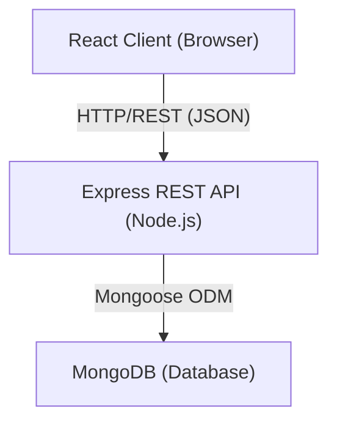

# Design Document: Task Manager

## Overview

A full-stack task manager built with React.js (front-end), Express.js (back-end API), and MongoDB (database). The app follows a standard client-server architecture where the React client communicates with the Express REST API over HTTP, and the API persists data in MongoDB via Mongoose.

## Architecture



The project is split into two top-level directories:
- `server/` — Node.js + Express API
- `client/` — React application (Create React App or Vite)

## Components and Interfaces

### Back-End (server/)

```
server/
  index.js          — Entry point, starts Express and connects to MongoDB
  routes/
    tasks.js        — Task CRUD route handlers
  models/
    Task.js         — Mongoose Task schema/model
```

**REST API Endpoints**

| Method | Path           | Description              |
|--------|----------------|--------------------------|
| GET    | /api/tasks     | Return all tasks         |
| POST   | /api/tasks     | Create a new task        |
| PUT    | /api/tasks/:id | Update a task by ID      |
| DELETE | /api/tasks/:id | Delete a task by ID      |

All endpoints consume and produce `application/json`.

### Front-End (client/)

```
client/src/
  App.jsx             — Root component, manages global task state
  api/
    tasks.js          — Axios wrapper functions for each API endpoint
  components/
    TaskList.jsx      — Renders the list of TaskItem components
    TaskItem.jsx      — Single task row with edit/delete controls
    TaskForm.jsx      — Controlled form for create and update
```

## Data Models

### Task (MongoDB / Mongoose)

```js
{
  _id:         ObjectId,   // auto-generated
  title:       String,     // required, non-empty
  description: String,     // optional
  status:      String,     // enum: 'pending' | 'in-progress' | 'completed', default 'pending'
  createdAt:   Date,       // auto-set by Mongoose timestamps
  updatedAt:   Date        // auto-set by Mongoose timestamps
}
```

### API Request / Response shapes

**Create task — POST /api/tasks**
```json
// Request body
{ "title": "Buy milk", "description": "2% milk", "status": "pending" }

// Response 201
{ "_id": "...", "title": "Buy milk", "description": "2% milk", "status": "pending", "createdAt": "...", "updatedAt": "..." }
```

**Update task — PUT /api/tasks/:id**
```json
// Request body (partial update supported)
{ "status": "completed" }

// Response 200
{ "_id": "...", "title": "Buy milk", "status": "completed", ... }
```

## Correctness Properties

*A property is a characteristic or behavior that should hold true across all valid executions of a system — essentially, a formal statement about what the system should do. Properties serve as the bridge between human-readable specifications and machine-verifiable correctness guarantees.*

### Property-Based Testing Overview

Property-based testing (PBT) validates software correctness by testing universal properties across many generated inputs. Each property is a formal specification that should hold for all valid inputs.

The PBT library used for the back-end is **[fast-check](https://github.com/dubzzz/fast-check)** (JavaScript/TypeScript). Tests run via **Jest**.

---

Property 1: Task creation persistence (round-trip)
*For any* valid task payload (non-empty title, optional description, valid status), creating a task via the API and then fetching all tasks should result in a collection that contains a task with the same title, description, and status.
**Validates: Requirements 1.1, 1.3, 2.2**

---

Property 2: Invalid title rejected
*For any* string composed entirely of whitespace (or an empty string), submitting it as a task title to the API should result in a 400 response, and the task should not be added to the database.
**Validates: Requirements 1.2**

---

Property 3: Update reflects in fetch
*For any* existing task and any valid update payload, updating the task via the API and then fetching all tasks should return a task whose fields match the update payload.
**Validates: Requirements 3.1, 3.3**

---

Property 4: Delete removes task
*For any* existing task, deleting it via the API and then fetching all tasks should return a collection that does not contain the deleted task.
**Validates: Requirements 4.1, 4.3**

---

Property 5: Non-existent ID returns 404
*For any* string that is a valid MongoDB ObjectId format but does not correspond to an existing task, issuing a PUT or DELETE request with that ID should return a 404 response.
**Validates: Requirements 3.2, 4.2**

---

Property 6: Malformed ID returns 400
*For any* string that is not a valid MongoDB ObjectId format, issuing a PUT or DELETE request with that string as the ID should return a 400 response.
**Validates: Requirements 6.2**

---

## Error Handling

| Scenario                            | HTTP Status | Response Body                        |
|-------------------------------------|-------------|--------------------------------------|
| Missing or empty title on create    | 400         | `{ "error": "Title is required" }`   |
| Malformed MongoDB ObjectId          | 400         | `{ "error": "Invalid task ID" }`     |
| Task not found (update/delete)      | 404         | `{ "error": "Task not found" }`      |
| Unhandled server error              | 500         | `{ "error": "Internal server error"}`|

The API uses a centralized Express error-handling middleware (4-argument handler) as the last middleware registered.

MongoDB connection failures are caught at startup; the process logs the error and exits with code 1.

## Testing Strategy

### Dual Testing Approach

Both unit tests and property-based tests are required and complementary.

**Unit tests** (Jest):
- Verify specific API response shapes and status codes
- Test edge cases: empty title, missing fields, wrong ID format
- Co-located in `server/__tests__/`

**Property-based tests** (Jest + fast-check):
- Verify universal properties across randomly generated inputs
- Each property test runs a minimum of **100 iterations**
- Annotated with the property they validate:
  - Tag format: `Feature: task-manager, Property {N}: {property_text}`
- Located alongside unit tests in `server/__tests__/`

### Front-End Tests (React Testing Library + Jest)
- Verify that the task list renders tasks returned from the API
- Verify that the create form calls the API and updates the list
- Verify that loading and error states are displayed correctly

### Property Test Summary

| Property | Description                             | Requirements |
|----------|-----------------------------------------|--------------|
| 1        | Task creation round-trip                | 1.1, 1.3, 2.2|
| 2        | Whitespace/empty title rejected         | 1.2          |
| 3        | Update reflected in subsequent fetch    | 3.1, 3.3     |
| 4        | Delete removes task from collection     | 4.1, 4.3     |
| 5        | Non-existent valid ObjectId → 404       | 3.2, 4.2     |
| 6        | Malformed ID → 400                      | 6.2          |
